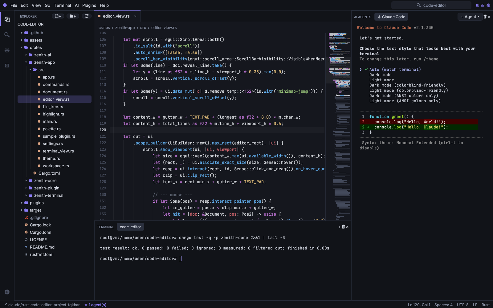

# ◆ Zenith

**Fast. Extensible. AI-native.** — Rust tilida yozilgan, VS Code uslubidagi kod muharriri.
Claude Code, Codex, Gemini CLI, Aider kabi AI agentlar to'g'ridan-to'g'ri editor ichida ishlaydi.
macOS, Windows va Linux'da ishlaydi.



## Imkoniyatlar

| | |
|---|---|
| ⚡ **Tezlik** | Rust + GPU orqali chizish (egui/OpenGL). Faqat ko'rinadigan qatorlar chiziladi; sintaksis ranglash inkremental va har kadrda vaqt bilan cheklangan — katta fayllarda ham UI qotmaydi. |
| ✳ **AI agentlar** | O'ng tomondagi AI panelda haqiqiy agent CLI'lari ishlaydi: **Claude Code**, OpenAI **Codex**, **Gemini CLI**, **Aider**, **OpenCode** yoki o'zingizning har qanday CLI'ingiz. "Ask AI" (`Ctrl+Shift+I`) belgilangan kodni fayl yo'li bilan agentga yuboradi. Agent fayllarni o'zgartirsa, editor ularni avtomatik qayta yuklaydi. |
| 🧩 **Pluginlar** | Plugin — istalgan tildagi dastur (Python, JS, Go, Rust…). Alohida jarayonda ishlaydi, shuning uchun plugin xatosi editorni hech qachon qotirmaydi yoki buzmaydi. [Qo'llanma →](docs/PLUGINS.md) |
| ⌨ **Terminal** | To'liq terminal emulyatori (PTY: Unix'da openpty, Windows'da ConPTY), 256/truecolor, scrollback, sichqoncha, nusxa olish, bir nechta tab. |
| 📝 **Muharrir** | Sintaksis ranglash (~200 til), avtomatik qavs yopish, aqlli indent, bir nechta tab, undo/redo, qidirish va almashtirish, minimap, indent chiziqlari, qavs juftini ko'rsatish, qatorni ko'chirish/nusxalash, izoh qo'yish. |
| 🧠 **LSP (til serverlari)** | Avtomatik to'ldirish, xatolar va ogohlantirishlar (qizil to'lqinli chiziq), hover hujjatlari, ta'rifga o'tish (`F12` / `Ctrl+bosish`). O'rnatilgan bo'lsa avtomatik ishga tushadi: **rust-analyzer**, **pyright**, **typescript-language-server**, **gopls**, **clangd** va boshqalar. |
| 🔍 **Navigatsiya** | Buyruqlar palitrasi (`Ctrl+Shift+P`), fuzzy fayl qidirish (`Ctrl+P`), fayllar ichida qidirish (`Ctrl+Shift+F`, `.gitignore`'ni hisobga oladi), qatorga o'tish. |
| 🎨 **Chiroyli UI** | Zenith Midnight (qorong'i) va Daylight (yorug') temalari, 30+ sintaksis temasi, JetBrains Mono + Inter shriftlari. |

## O'rnatish va ishga tushirish

Talab: [Rust](https://rustup.rs) (stable).

```bash
git clone https://github.com/abbosjon-dev/code-editor
cd code-editor
cargo run --release            # yoki: cargo run --release -- /papka/yo'li
```

Tayyor binar fayl: `target/release/zenith` (Windows'da `zenith.exe`).

**Linux** uchun qo'shimcha tizim kutubxonalari (Debian/Ubuntu):

```bash
sudo apt install libxkbcommon-x11-0 libxkbcommon-dev libgl1-mesa-dev libwayland-dev libx11-dev
```

`v*` teg qo'yilganda GitHub Actions avtomatik ravishda macOS (Intel + Apple Silicon), Windows va Linux uchun relizlarni yig'adi.

## AI agentlardan foydalanish

1. Agent CLI'sini o'rnating, masalan Claude Code: `npm install -g @anthropic-ai/claude-code`
   (yoki chap paneldagi ✳ **AI Agents** bo'limida "Install" tugmasini bosing).
2. Papkani oching (`Ctrl+Shift+O`), so'ng `Ctrl+Shift+P` → **AI: Start Claude Code**.
3. Kodni belgilang va `Ctrl+Shift+I` bosing — savolingiz kod bilan birga agentga yuboriladi.
   O'ng tugma menyusida ham: *Explain / Find Bugs / Write Tests / Refactor*.

O'z agentingizni qo'shish (`settings.toml`, `Ctrl+,`):

```toml
default_agent = "claude"

[[agents]]
id = "my-agent"
name = "My Agent"
command = "my-agent-cli"
args = ["--model", "best"]
```

API kalitlarni sozlamalarga yozmang — agentlar sizning shell muhitingizdagi o'zgaruvchilarni meros qilib oladi.

## Til serverlari (LSP)

Kerakli server o'rnatilgan bo'lsa, faylni ochishingiz bilan ishlay boshlaydi — hech narsa sozlash shart emas.
Holatni **Plugins** panelidagi *Language servers* bo'limida ko'rasiz (o'rnatilmaganlarini ⬇ tugmasi bilan o'rnatish mumkin).


| Til | Server | O'rnatish |
|---|---|---|
| Rust | rust-analyzer | `rustup component add rust-analyzer` |
| Python | pyright | `npm install -g pyright` |
| TypeScript / JavaScript | typescript-language-server | `npm install -g typescript typescript-language-server` |
| Go | gopls | `go install golang.org/x/tools/gopls@latest` |
| C / C++ | clangd | paket menejeri orqali |

Boshqa server qo'shish (`settings.toml`):

```toml
[[language_servers]]
name = "pylsp"
command = "pylsp"
languages = ["python"]
```

## Klaviatura

| Amal | Windows / Linux | macOS |
|---|---|---|
| Buyruqlar palitrasi | `Ctrl+Shift+P` / `F1` | `⌘⇧P` |
| Faylni tez ochish | `Ctrl+P` | `⌘P` |
| Papka ochish | `Ctrl+Shift+O` | `⌘⇧O` |
| Saqlash | `Ctrl+S` | `⌘S` |
| Qidirish / Almashtirish | `Ctrl+F` / `Ctrl+H` | `⌘F` / `⌘⌥F` |
| Fayllarda qidirish | `Ctrl+Shift+F` | `⌘⇧F` |
| Qatorga o'tish | `Ctrl+G` | `⌘G` |
| Terminal | ``Ctrl+` `` | ``⌃` `` |
| AI panel | `Ctrl+Shift+A` | `⌘⇧A` |
| AI'dan so'rash (belgilangan kod) | `Ctrl+Shift+I` | `⌘⇧I` |
| Belgilangan kodni agentga yuborish | `Ctrl+Shift+L` | `⌘⇧L` |
| Avtomatik to'ldirish | `Ctrl+Space` | `⌃Space` |
| Ta'rifga o'tish | `F12` / `Ctrl+bosish` | `F12` / `⌘+bosish` |
| Keyingi xato | `F8` | `F8` |
| Izoh qo'yish/olib tashlash | `Ctrl+/` | `⌘/` |
| Qatorni ko'chirish / nusxalash | `Alt+↑↓` / `Alt+Shift+↑↓` | `⌥↑↓` / `⌥⇧↑↓` |
| Keyingi moslikni belgilash | `Ctrl+D` | `⌘D` |
| Qatorni o'chirish | `Ctrl+Shift+K` | `⌘⇧K` |
| Yon panel | `Ctrl+B` | `⌘B` |
| Masshtab | `Ctrl+=` / `Ctrl+-` / `Ctrl+0` | `⌘=` / `⌘-` / `⌘0` |

Terminal fokusda bo'lganda (Windows/Linux) oddiy `Ctrl+harf` kombinatsiyalari shell'ga uzatiladi (`Ctrl+C`, `Ctrl+R`…); global buyruqlar `Ctrl+Shift+…` orqali ishlaydi.

## Arxitektura

```
crates/
├── zenith-core      Matn buferi (ropey), kursor/belgilash, undo/redo, qidiruv — UI'ga bog'liq emas, testlangan
├── zenith-terminal  PTY + VT100 emulyatori (portable-pty, vt100), terminal so'rovlariga javob
├── zenith-plugin    Plugin xosti: manifest, JSON-lines protokoli, fon oqimlari
├── zenith-lsp       Language Server Protocol mijozi (JSON-RPC, UTF-16 pozitsiyalar, snippetlar)
├── zenith-ai        AI agent profillari (Claude Code, Codex, Gemini, Aider…), prompt yasash
└── zenith-app       GUI (eframe/egui): muharrir vidjeti, panellar, palitra, temalar
plugins/examples/    Namuna plugin (Python)
```

Batafsil: [docs/ARCHITECTURE.md](docs/ARCHITECTURE.md).

## Rivojlantirish

```bash
cargo test --workspace       # barcha testlar
cargo clippy --workspace     # lint
cargo fmt --all              # formatlash
```

Sozlamalar joyi: Linux `~/.config/zenith/`, macOS `~/Library/Application Support/dev.Zenith.zenith/`,
Windows `%APPDATA%\Zenith\zenith\config\` (`ZENITH_CONFIG_DIR` bilan o'zgartirish mumkin).

## Litsenziya

Apache-2.0. Shriftlar: JetBrains Mono va Inter — SIL Open Font License (`assets/fonts/`).
