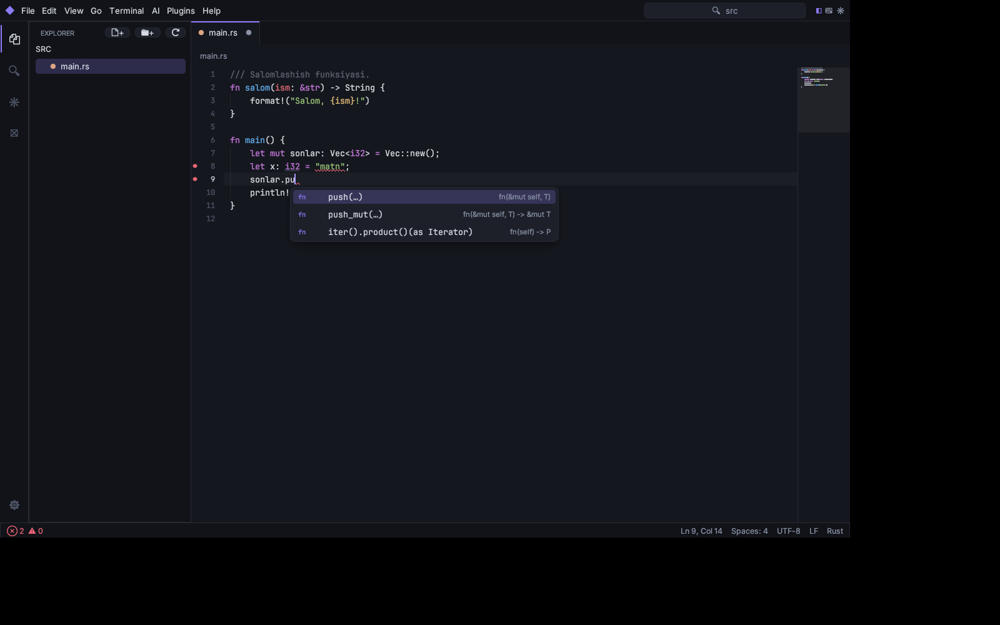
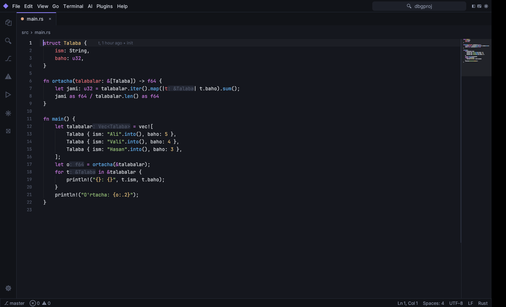
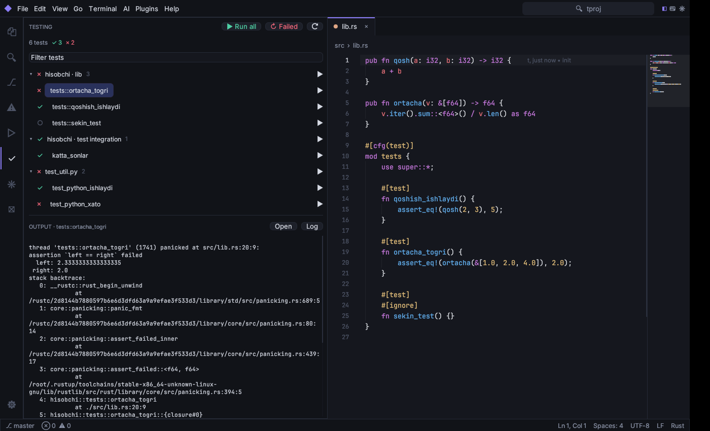
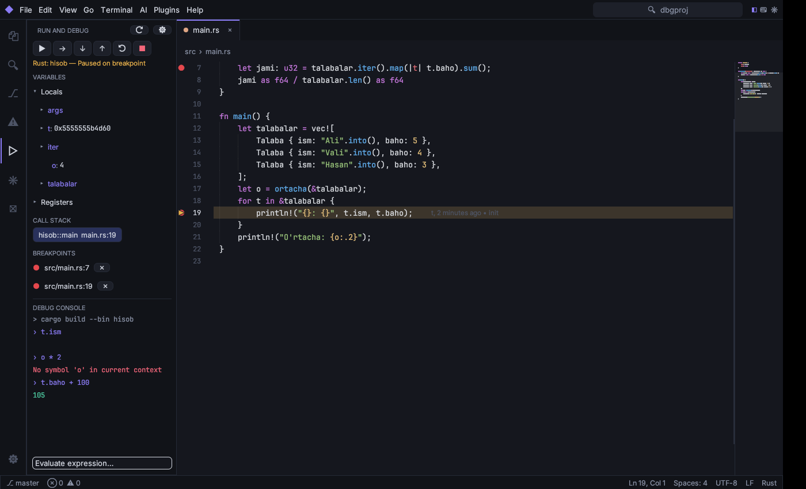
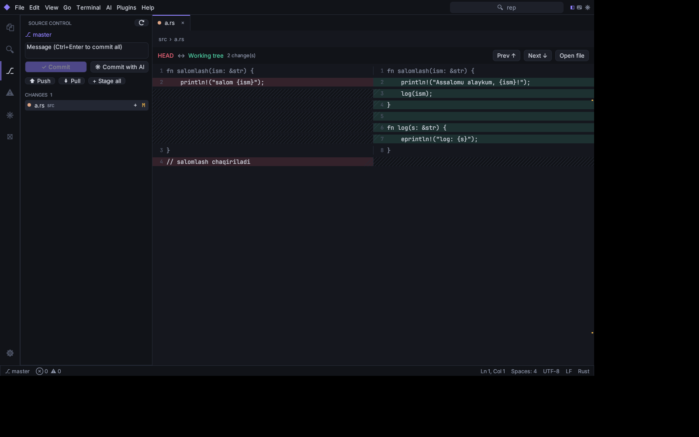
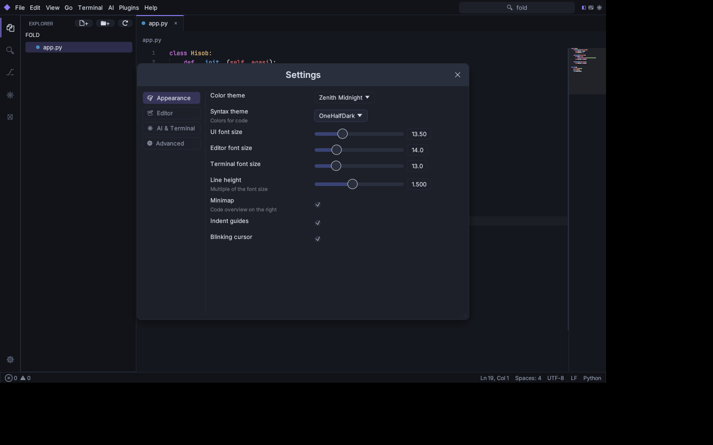

# ◆ Zenith

**Fast. Extensible. AI-native.** — Rust tilida yozilgan, VS Code uslubidagi kod muharriri.
Claude Code, Codex, Gemini CLI, Aider kabi AI agentlar to'g'ridan-to'g'ri editor ichida ishlaydi.
macOS, Windows va Linux'da ishlaydi.


## Imkoniyatlar

| | |
|---|---|
| ⚡ **Tezlik** | Rust + GPU orqali chizish (egui/OpenGL). Faqat ko'rinadigan qatorlar chiziladi; sintaksis ranglash inkremental va har kadrda vaqt bilan cheklangan — katta fayllarda ham UI qotmaydi. 120 MB log fayl ~0,3 s da ochiladi, unda yozish va qidirish bir zumda. |
| ✳ **AI agentlar** | O'ng tomondagi AI panelda haqiqiy agent CLI'lari ishlaydi: **Claude Code**, OpenAI **Codex**, **Gemini CLI**, **Aider**, **OpenCode** yoki o'zingizning har qanday CLI'ingiz. "Ask AI" (`Ctrl+Shift+I`) belgilangan kodni fayl yo'li bilan agentga yuboradi. Savolda `@` yozsangiz — loyiha fayllari ro'yxati chiqadi (`@src/main.rs` kabi boshqa fayllarni ham kontekstga qo'shish). Agent faylni o'zgartirsa, editor uni darhol yuklaydi va **o'zgarishlarni diff ko'rinishida** ko'rsatadi — har birini qoldirish yoki bitta tugma bilan qaytarish mumkin. **⧉ Changes** oynasi esa agent ishga tushgandan beri o'zgargan *barcha* fayllarni (yangi, o'zgargan, o'chirilgan) bir joyda yonma-yon diff bilan ko'rsatadi: har faylni yoki hammasini **Keep / Revert**. |
| 🧩 **Pluginlar** | Plugin — istalgan tildagi dastur (Python, JS, Go, Rust…). Alohida jarayonda ishlaydi, shuning uchun plugin xatosi editorni hech qachon qotirmaydi yoki buzmaydi. Yoki **WebAssembly** plugin — editor ichida sandbox'da ishlaydi (fayl va tarmoqqa kira olmaydi), bitta `.wasm` fayl hamma OS'da. Pluginlar buyruqlar, **o'z yon panellarini** (masalan, TODO Tree) va **status qatori elementlarini** qo'sha oladi. **Marketplace** — Plugins panelida pluginlarni qidirish, bir tugma bilan o'rnatish, yangilash va o'chirish. [Qo'llanma →](docs/PLUGINS.md) |
| ⌨ **Terminal** | To'liq terminal emulyatori (PTY: Unix'da openpty, Windows'da ConPTY), 256/truecolor, scrollback, sichqoncha, nusxa olish, bir nechta tab, **ikki terminal yonma-yon** (‖ tugmasi yoki *Terminal: Split Terminal*; AI panelda ikki agent yonma-yon). `Ctrl+F` — chiqish va scrollback ichida qidirish (Enter / Shift+Enter, topilganlar belgilanadi). `Ctrl+bosish` bilan chiqishdagi `fayl:qator:ustun` havolalarini muharrirda va URL'larni brauzerda ochadi. |
| 📝 **Muharrir** | **Sticky scroll** (pastga aylantirganda joriy funksiya/klass/impl sarlavhalari tepada qotib turadi, bossangiz — o'sha qatorga), **Zen rejimi** (`Ctrl+Alt+Z`: panellarsiz, to'liq ekran, kod markazda; `Esc Esc` — chiqish), **fayllarni solishtirish** (Explorer'da *Select for Compare* → boshqa faylda *Compare with…*, yoki *File → Compare Active File With… / With Clipboard*: yonma-yon diff, saqlanmagan o'zgarishlar ham ko'rinadi), **Snippetlar** (`test`, `fn`, `for`, `def`, `iferr`… yozib `Tab`; maydonlar orasida `Tab` / `Shift+Tab`; o'zingiznikilar — *Snippets: Edit User Snippets*), **Multi-cursor** (Ctrl+D, Alt+bosish, Ctrl+Alt+↑↓), **ustun bo'yicha belgilash** (`Shift+Alt+sudrash`), **split editor** (`Ctrl+\`), **kod bloklarini yig'ish** (gutter'dagi ▾ yoki `Ctrl+Shift+[` / `]`), **so'zlarni o'rash** (`Alt+Z`), **Markdown preview** (`Ctrl+Alt+P`, rasmlar bilan), qator ichida xato xabarlari, sintaksis ranglash (~200 til), avtomatik qavs yopish, aqlli indent, bir nechta tab, undo/redo, qidirish va almashtirish, minimap, indent chiziqlari, qavs juftini ko'rsatish, qatorni ko'chirish/nusxalash, izoh qo'yish. |
| 🌳 **Tree-sitter** | Rust, Python, JavaScript/TypeScript (JSX/TSX), Go, C/C++, JSON, Bash, HTML, CSS uchun sintaksis daraxti asosida aniq ranglash va **sintaktik yig'ish** (folding) — har tahrirda inkremental qayta tahlil (20 ming qatorgacha bo'lgan faylda bir tugma ~5 ms). Boshqa tillar uchun TextMate grammatikalari (syntect). Sozlamalar → Editor → Tree-sitter. |
| 🧠 **LSP (til serverlari)** | Avtomatik to'ldirish, xatolar va ogohlantirishlar (qizil to'lqinli chiziq), hover hujjatlari, ta'rifga o'tish (`F12` / `Ctrl+bosish`), havolalarni topish (`Shift+F12`), nomni hamma joyda o'zgartirish (`F2`), formatlash (`Shift+Alt+F`, ixtiyoriy saqlashda formatlash), parametr maslahatlari, tezkor tuzatishlar (`Ctrl+.` / 💡), **avtomatik import** (masalan `HashMa` yozib `HashMap`ni tanlasangiz, `use std::collections::HashMap;` o'zi qo'shiladi), **Organize Imports** (`Shift+Alt+O`: import'larni saralash va takrorlarni olib tashlash; til serverisiz ham Rust/Python/JS/TS/Go/Java uchun ishlaydi), *Add All Missing Imports*, fayldagi belgiga o'tish (`Ctrl+T`), butun loyihadagi belgilar (`Ctrl+Shift+T`), **inlay hints** — o'zgaruvchi turlari va parametr nomlari qator ichida. **Semantik ranglash** — til serveri belgining nima ekanini aytadi (parametr, maydon, tur, makros…) va rang shunga qarab tanlanadi. O'rnatilgan bo'lsa avtomatik ishga tushadi: **rust-analyzer**, **pyright**, **typescript-language-server**, **gopls**, **clangd** va boshqalar. |
| ⎇ **Git** | Gutter'da o'zgarish belgilari (qo'shilgan / o'zgargan / o'chirilgan), Source Control paneli (`Ctrl+Shift+G`): stage/unstage, commit (`Ctrl+Enter`), push/pull, stash, merge konfliktlarini hal qilish, fayl daraxtida rangli holat. **✳ Commit with AI** — agent diff'ni ko'rib, commit'ni o'zi yozadi. |
| ▶ **Run: loyihani ishga tushirish** | `Ctrl+F5` — loyiha turini o'zi aniqlaydi (Cargo, npm/pnpm/yarn/bun, **Flutter**, **Expo / React Native**, Django/Python, Go, Docker Compose) va alohida terminal tabida ishga tushiradi. Chiqarilgan `localhost` manzillari topiladi; **Web preview** sahifani kod yonida, editor ichida ko'rsatadi (iPhone/Pixel/iPad o'lchamlari bilan). Flutter: qurilma tanlash, **hot reload** (saqlaganda ham), debug. Expo: **Expo Go uchun QR kod**, web versiya preview'da. **Emulator/simulator**larni ishga tushirish va **telefon ekranini editor ichida** ko'rish va boshqarish (adb). [Batafsil ↓](#run-loyihani-ishga-tushirish) |
| 🌐 **SSH orqali ishlash** | *File → Open Remote Folder (SSH)…* — uzoq serverdagi papkani ochish: fayllar mahalliy nusxada tez tahrirlanadi, saqlash serverga yuklanadi, terminal va AI agentlar serverning o'zida ishlaydi. |
| 🪟 **Bir nechta oyna** | *File → New Window* (`Ctrl+Shift+N`) — yangi oyna (masalan, ikkinchi monitor uchun); *View: Move Editor into New Window* — joriy faylni yangi oynaga ko'chirish. Asosiy oynaning sessiyasi saqlanadi. |
| 🗂 **Bir nechta papka** | Bir oynada bir nechta loyiha papkasi (multi-root): Explorer, tezkor ochish va fayllarda qidirish hammasini qamraydi; har bir papka o'z Git repo'si (Source Control'da repo tanlash, gutter/blame/branch) va o'z til serveriga ega; sessiyada saqlanadi. |
| 🔍 **Navigatsiya** | yuqoridagi yo'lda kursor turgan belgi (`src › lib.rs › tests › ƒ ortacha_togri`; bossangiz — qo'shni belgilar ro'yxati), **Outline** paneli (≡: fayldagi funksiya/klass/struct daraxti, kursor turgan joy belgilanadi, bosib o'tish, filtr; LSP bo'lmasa — tezkor skan), Loyihalar orasida tez o'tish (`Ctrl+R`; har loyiha ochiq fayllari va kursorlari bilan qaytadi, SSH papkalar ham), buyruqlar palitrasi (`Ctrl+Shift+P`), fuzzy fayl qidirish (`Ctrl+P`), fayllar ichida qidirish va almashtirish (`Ctrl+Shift+F`: regex, butun so'z, katta-kichik harf, `$1` guruhlar, oldindan ko'rish; `.gitignore`'ni hisobga oladi), qatorga o'tish. |
| 🎨 **Chiroyli UI** | Zenith Midnight (qorong'i) va Daylight (yorug') temalari, 30+ sintaksis temasi, JetBrains Mono + Inter shriftlari. |

## Yuklab olish

[Releases](https://github.com/abbosjon-dev/code-editor/releases) sahifasidan:

| OS | Fayl | O'rnatish |
|---|---|---|
| **macOS** (Apple Silicon / Intel) | `Zenith-…-macos-arm64.dmg` / `…-x86_64.dmg` | DMG'ni oching, Zenith'ni Applications'ga torting. Imzo sertifikatisiz yig'ilgan bo'lsa: birinchi marta **o'ng tugma → Open** (yoki `xattr -dr com.apple.quarantine /Applications/Zenith.app`). |
| **Windows** | `Zenith-…-x86_64.msi` yoki `zenith-…-windows-x86_64.zip` | MSI — o'rnatuvchi (Start menyu, `PATH`, o'chirish Sozlamalardan); ZIP — `zenith.exe` ni to'g'ridan-to'g'ri ishga tushiring. |
| **Har qanday Linux** | `Zenith-…-x86_64.AppImage` | `chmod +x Zenith-*.AppImage && ./Zenith-*.AppImage` |
| **Ubuntu / Debian** | `zenith_…_amd64.deb` | `sudo apt install ./zenith_…_amd64.deb` |
| **Boshqa Linux** | `zenith-…-linux-x86_64.tar.gz` | Arxivni oching va `./install.sh` (foydalanuvchi uchun, `~/.local`ga). |

Paketlarni o'zingiz yig'ish: `bash packaging/package.sh` (natija `dist/` papkasida; AppImage uchun
`appimagetool`, MSI uchun WiX — `dotnet tool install --global wix`).

**Kod imzosi (ixtiyoriy).** Release workflow quyidagi repository secret'lari bo'lsa imzolaydi, bo'lmasa o'tkazib yuboradi:
macOS — `APPLE_CERTIFICATE` (Developer ID .p12, base64), `APPLE_CERTIFICATE_PASSWORD`, `MACOS_SIGN_IDENTITY`,
notarizatsiya uchun `APPLE_ID`, `APPLE_TEAM_ID`, `APPLE_APP_PASSWORD`; Windows — `WINDOWS_CERTIFICATE` (.pfx, base64),
`WINDOWS_CERTIFICATE_PASSWORD`. Mahalliy yig'ishda xuddi shu nomdagi muhit o'zgaruvchilari ishlatiladi
(`packaging/package.sh` boshidagi izohga qarang).

**Yangilanishlar.** Zenith kuniga bir marta GitHub'dagi oxirgi release'ni tekshiradi va yangi versiya chiqsa status
qatorida **⬆ Update** ko'rsatadi. Uni bossangiz — **Install and restart**: Zenith qanday o'rnatilgan bo'lsa, o'shanga mos
paketni yuklab oladi (AppImage, tar.gz, ZIP, macOS DMG ichidagi .app, MSI), GitHub bergan SHA-256 bilan tekshiradi,
o'rnatadi va qayta ishga tushiradi (MSI uchun o'rnatuvchi ochiladi; .deb uchun `sudo apt install …` buyrug'i
ko'rsatiladi). Siz so'ramaguningizcha hech narsa o'rnatilmaydi. *Help → Check for Updates* — qo'lda tekshirish;
Sozlamalar → Advanced'da o'chirish mumkin.

## Manba koddan ishga tushirish

Talab: [Rust](https://rustup.rs) (stable).

```bash
git clone https://github.com/abbosjon-dev/code-editor
cd code-editor
cargo run --release            # yoki: cargo run --release -- /papka/yo'li
```

Tayyor binar fayl: `target/release/zenith` (Windows'da `zenith.exe`).

**Linux** uchun qo'shimcha tizim kutubxonalari (Debian/Ubuntu):

```bash
sudo apt install libxkbcommon-x11-0 libxkbcommon-dev libgl1-mesa-dev libwayland-dev libx11-dev
```

`v*` teg qo'yilganda GitHub Actions avtomatik ravishda macOS (Intel + Apple Silicon), Windows va Linux uchun relizlarni yig'adi.

## AI agentlardan foydalanish

1. Agent CLI'sini o'rnating, masalan Claude Code: `npm install -g @anthropic-ai/claude-code`
   (yoki chap paneldagi ✳ **AI Agents** bo'limida "Install" tugmasini bosing).
2. Papkani oching (`Ctrl+Shift+O`), so'ng `Ctrl+Shift+P` → **AI: Start Claude Code**.
3. Kodni belgilang va `Ctrl+Shift+I` bosing — savolingiz kod bilan birga agentga yuboriladi. `@` bilan boshqa fayllarni ham eslatish mumkin (↑↓ tanlash, Tab/Enter qo'yish).
   O'ng tugma menyusida ham: *Explain / Find Bugs / Write Tests / Refactor*.

O'z agentingizni qo'shish (`settings.toml`, `Ctrl+,`):

```toml
default_agent = "claude"

[[agents]]
id = "my-agent"
name = "My Agent"
command = "my-agent-cli"
args = ["--model", "best"]
```

Editorni yopib qayta ochganingizda ochiq fayllar (kursor joyi bilan), panellar, terminallar va AI agentlar tiklanadi;
Claude Code o'zining oxirgi suhbatini `--continue` bilan davom ettiradi (agentga `resume_args` bilan o'zingiz ham qo'shishingiz mumkin).

API kalitlarni sozlamalarga yozmang — agentlar sizning shell muhitingizdagi o'zgaruvchilarni meros qilib oladi.

## AI bilan inline tahrir (Ctrl+K)

Kodni belgilang va `Ctrl+K` (macOS: `⌘K`) — ko'rsatma yozing ("xatolarni qayta ishlashni qo'sh", "async qil"…) va
Enter. Standart AI agent (Claude Code `-p`, Codex `exec`, Gemini `-p`, OpenCode `run`) bir martalik rejimda javob
beradi; javob **yozilayotganda jonli** ko'rinadi (Claude Code — `stream-json` orqali), natija **yonma-yon diff** ko'rinishida chiqadi: **✓ Accept** (`Ctrl+Enter`) yoki **✕ Reject** (`Esc`).
Qabul qilmaguningizcha fayl o'zgarmaydi; ko'rsatmani o'zgartirib Enter — qayta so'raydi. **Bir nechta belgilash** (`Ctrl+D`, `Alt+bosish`, `Shift+Alt+sudrash`) bo'lsa — hammasi bitta so'rovda o'zgartiriladi
va har biri uchun alohida diff chiqadi; *AI: Edit Whole File* — butun faylni. Hech narsa belgilanmagan
bo'lsa — kursor joyiga yangi kod yoziladi. O'z agentingiz uchun `settings.toml` da `oneshot_args = ["-p", "{prompt}"]`.
SSH papkada agent serverda ishlaydi.

## AI o'zgarishlarini ko'rib chiqish

Agent (masalan Claude Code) ochiq faylni o'zgartirsa, tepada banner chiqadi: **Review diff** — har bir o'zgarishni
ko'rish va kerak bo'lmaganini **↺ Revert this change** bilan qaytarish; **Keep** — hammasini qabul qilish;
**Revert all** — avvalgi holatga qaytarish. Saqlanmagan tahrirlaringiz bo'lsa, ular ustiga yozilmaydi.


## Til serverlari (LSP)

Kerakli server o'rnatilgan bo'lsa, faylni ochishingiz bilan ishlay boshlaydi — hech narsa sozlash shart emas.
Holatni **Plugins** panelidagi *Language servers* bo'limida ko'rasiz (o'rnatilmaganlarini ⬇ tugmasi bilan o'rnatish mumkin).



| Til | Server | O'rnatish |
|---|---|---|
| Rust | rust-analyzer | `rustup component add rust-analyzer` |
| Python | pyright | `npm install -g pyright` |
| TypeScript / JavaScript | typescript-language-server | `npm install -g typescript typescript-language-server` |
| Go | gopls | `go install golang.org/x/tools/gopls@latest` |
| C / C++ | clangd | paket menejeri orqali |

Saqlashda avtomatik formatlash: `settings.toml` da `format_on_save = true`.

Boshqa server qo'shish (`settings.toml`):

```toml
[[language_servers]]
name = "pylsp"
command = "pylsp"
languages = ["python"]
```




## Run: loyihani ishga tushirish

**Run and Debug** paneli (`Ctrl+Shift+D`) tepasidagi **RUN** bo'limi yoki **Run** menyusi.

- **Avtomatik aniqlash.** Papka (va uning bir pog'ona ichidagi papkalar, masalan `mobile/`, `web/`) qarab chiqiladi:
  `Cargo.toml` → `cargo run`, `package.json` skriptlari (`dev`, `start`, `serve`…; lock fayliga qarab npm / pnpm / yarn / bun),
  `pubspec.yaml` → `flutter run`, Expo → `npx expo start`, `manage.py` / `main.py`, `go.mod`, `compose.yaml`.
- **`.zenith/run.toml`** — o'z buyruqlaringiz (⚙ tugmasi shablonni ochadi):
  ```toml
  [[run]]
  name = "API"
  command = "uvicorn app:app --reload"
  cwd = "backend"
  url = "http://localhost:8000/docs"   # preview uchun (ixtiyoriy)
  [run.env]
  DEBUG = "1"
  ```
- **▶ Run** (`Ctrl+F5`) — har konfiguratsiya o'z terminal tabida ishlaydi (ranglar, interaktiv kiritish). Panelda: ■ Stop, ↻ Restart,
  chiqishda topilgan URL'lar (bosing — brauzerda), status qatorida `▶ nomi  http://localhost:5173`.
- **Compound** — bir nechta konfiguratsiyani birga ishga tushirish (masalan backend + frontend):
  ```toml
  [[compound]]
  name = "Full stack"
  runs = ["API", "Web: dev server"]
  ```
  Ular bitta guruh ostida chiqadi: **↻ Restart all / ■ Stop all**, *Run: Stop* butun guruhni to'xtatadi.
- **Env fayllar** — Run panelidagi **Env** ro'yxati loyihadagi `.env`, `.env.staging`, `.env.production`… fayllarini
  ko'rsatadi; tanlangani jarayonga yuklanadi (konfiguratsiyadagi `env_file = ".env.staging"` ham). Flutter'ga qo'shimcha
  `--dart-define-from-file` beriladi — qiymatlar `String.fromEnvironment` orqali o'qiladi.
- **SSH papkada** buyruq serverda ishlaydi, `localhost` portlari esa avtomatik sizning kompyuteringizga forward qilinadi (`ssh -L`).
- **Xatolar → Problems.** Run chiqishidagi kompilyatsiya va runtime xatolari (rustc/cargo, gcc/clang, Go, Dart/Flutter,
  TypeScript, Python traceback) Problems panelida chiqadi va bosganda kerakli qatorga o'tadi; keyingi muvaffaqiyatli
  yig'ish (hot reload, "Compiled successfully"…) eskilarini tozalaydi. Sessiya kartasida `⊗ 2  ⚠ 1`.
- **🔨 Build.** Flutter: APK, App Bundle (Play Store), IPA va macOS (macOS'da), web, desktop, `flutter install`.
  Expo: EAS cloud build (Android/iOS), lokal `run:android` / `run:ios`, web eksport. Cargo/Go/Compose/`npm run build`.
  Tugagach kartada nima yig'ilgani (📦 APK, `build/web/`…) — **Reveal** va APK uchun **Install on device** (`adb install -r`).
  `android/key.properties` bo'lmasa — release imzo haqida eslatma va qo'llanma havolasi.

### Web preview

URL yonidagi **◧ Preview** (yoki *Run: Open Web Preview…*) — sahifa kod yonidagi panelda, tizimning WebView'ida ochiladi
(macOS: WKWebView, Windows: WebView2). Manzil qatori, orqaga/oldinga/yangilash, **qurilma o'lchamlari** (iPhone 15, iPhone SE,
Pixel 8, Galaxy S23, iPad, Laptop — sahifa aynan shu CSS kenglikni ko'radi), *Reload on save*. Linux'da ichki preview uchun
`cargo build --release --features zenith-app/webview` (kerak: `libwebkit2gtk-4.1-dev`); usiz sahifa brauzerda ochiladi.
Tarmoqdagi (`192.168…`) URL yonidagi **▦** — telefonda ochish uchun QR kod.

### Flutter

- **Qurilma** tanlash: telefonlar, emulatorlar, simulatorlar, desktop, Chrome va **Web server (preview in Zenith)** —
  ilova kompilyatsiya bo'lgach to'g'ridan-to'g'ri editor ichidagi preview'da ochiladi.
- **⟳ Hot reload / ↻ Hot restart** tugmalari, *Run: Hot Reload*, va `.dart` faylni **saqlaganda avtomatik hot reload**
  (Sozlamalar → *Flutter: hot reload on save*).
- **🛠 DevTools** — Flutter DevTools, Widget inspector va Performance tugmalari ularni editor ichidagi preview'da ochadi.
- **Bir nechta qurilmada birdaniga**: Device ro'yxatida bir nechtasini belgilang — har biri o'z sessiyasida ishlaydi,
  hot reload (tugma, buyruq yoki saqlash) hammasiga boradi.
- **Debug** (`F5`): Flutter ilovalari debug konfiguratsiyasi sifatida avtomatik topiladi (`flutter debug_adapter`) —
  breakpoint'lar, qadam-baqadam, o'zgaruvchilar; tanlangan qurilmada ishlaydi, hot reload debug paytida ham ishlaydi.

### Expo / React Native

- `npx expo start` ishga tushgach panelda **QR kod** chiqadi — telefonda **Expo Go** (Android) yoki Kamera (iOS) bilan skanerlang.
- **Reload / Android / iOS / Web** tugmalari; **Web** — ilovaning web versiyasi editor ichidagi preview'da.

### Emulatorlar, simulatorlar va qurilma ekrani

- *Run → Start Emulator / Simulator…* — Android AVD'lar (`emulator`), iOS simulatorlar (`xcrun simctl`, macOS), Flutter emulatorlari.
- *Run → Show Device Screen…* (yoki qurilma yonidagi **📱 Screen**) — **telefon/emulator ekrani editor ichida**: bosish = tap,
  sudrash = swipe, g'ildirak = scroll, ◁ ○ ▢ ⏻ tugmalari, matn yozish. Ishlaydi har qanday Android qurilma bilan (USB orqali
  ulangan haqiqiy telefon ham) — faqat `adb` kerak. Ekran "raw" rejimda olinadi (PNG siqishsiz, ikki parallel oqim) —
  tez qurilmada ~25 fps; `scrcpy` o'rnatilgan bo'lsa, **↗ scrcpy** tugmasi to'liq tezlik va ovoz bilan ochadi.
- **📜 Logs** (qurilma yonida yoki *Run → Show Device Logs…*) — Android `adb logcat` (faqat xatolar / ogohlantirishlar /
  hammasi, yoki faqat shu ilova — paket nomi loyihadan olinadi), iOS simulator `log stream`. Dart exception'lari
  (`package:app/x.dart:42`) Problems paneliga tushadi va bosganda kodning o'sha qatoriga olib boradi. iOS simulator ekrani — ko'rish rejimida (Apple boshqarish API'sini bermaydi).

## HTTP so'rovlar, ma'lumotlar bazasi, Docker

- **HTTP (`.http` / `.rest` fayllar).** So'rovlar `###` bilan ajratiladi, `@base = http://localhost:3000` o'zgaruvchilari
  `{{base}}` ko'rinishida ishlatiladi (tanlangan `.env` va muhit o'zgaruvchilari ham). Kursor turgan so'rov
  `Ctrl+Alt+Enter` yoki fayl tepasidagi **▶ Send request** bilan yuboriladi (SSH papkada — serverning o'zidan).
  Javob paneli: status, vaqt, hajm, JSON chiroyli formatda, sarlavhalar, Copy / Open / Send again, oxirgi 30 ta javob.
  *Run → New HTTP Request File* — shablon.
  ```http
  @base = http://localhost:8000

  ### Mahsulotlar
  GET {{base}}/items
  Authorization: Bearer {{TOKEN}}
  ```
- **Ma'lumotlar bazalari** (⊜ paneli) — SQLite, PostgreSQL, MySQL/MariaDB (o'z CLI'lari orqali: `sqlite3`, `psql`, `mysql`).
  Ulanishlar avtomatik topiladi: `.env`dagi `DATABASE_URL`, papkadagi SQLite fayllar, `.zenith/databases.toml`; **+** bilan
  qo'shish. Jadvalni bosing — birinchi 200 qator; **New query** — SQL tab, `Ctrl+Alt+Enter` belgilangan yoki kursor
  turgan so'rovni bajaradi. Natija jadvalda (NULL alohida, katakni bosing — nusxa), CSV sifatida ochish, xatolar.
- **Konteynerlar** (⊟ paneli) — `docker ps -a` Compose loyihalari bo'yicha: start / stop / restart, loglar, ichida
  shell (`>_`), port bosilsa preview'da ochiladi, o'ng tugma — Remove.
- **⟲ Saqlaganda qayta ishga tushirish** — Run kartasidagi ⟲ yoqilsa, papkadagi fayl saqlanganda sessiya qayta
  ishga tushadi (backend serverlar uchun). `cargo-watch` o'rnatilgan bo'lsa — *Cargo: watch* ham chiqadi.

## Coverage, profiler, qator tarixi

- **Test coverage** — *Run → Run Tests with Coverage* testlarni coverage bilan ishga tushiradi (cargo llvm-cov,
  `flutter test --coverage`, jest/vitest, `go test -coverprofile`, coverage.py). Gutter yonida: **yashil** — test bajargan
  qator, **qizil** — bajarilmagan; status qatorida faylning foizi (`☂ 66%`). lcov, Cobertura XML va Go hisobotlari
  o'qiladi va o'zgarganda qayta yuklanadi.
- **Profiler** — Run panelidagi **⏱ Profile**: dastur py-spy (Python) yoki perf (Rust, Go, C…) ostida ishlaydi, tugagach
  **flame graph** ochiladi (bosish — zoom, ikki marta bosish — kodga o'tish, nom bo'yicha qidiruv) va eng ko'p vaqt olgan
  funksiyalar hamda qatorlar ro'yxati. *Run → Open Profile…* — boshqa vositalardan olingan profil (collapsed / perf script).
- **O'zgarishlar coverage'i** — *Testing: Coverage of Changes*: commit qilinmagan o'zgarishlar yoki butun branch (main'dan
  beri) qatorlarining necha foizi testlangan, testsiz qolgan qator raqamlari (bosing — o'sha joyga o'tadi).
- **Profillarni solishtirish** — profil oynasidagi *Compare with…*: oldingi profil bilan farq (qizil — ko'proq vaqt,
  ko'k — kamroq), eng ko'p o'zgargan funksiyalar ro'yxati. Native profillash: Linux'da perf (editor ichida),
  macOS / Windows'da **samply** (Firefox Profiler brauzerda ochiladi, `cargo install samply`).
- **Project setup** — *Run → Project Setup…*: `.zenith/` dagi run.toml, launch.toml, databases.toml, settings.toml holati
  (bor/yo'q, nechta konfiguratsiya, xatolar), shablondan yaratish, profillarni `.gitignore`ga qo'shish.
- **Qator tarixi** — belgilangan qatorlar yoki kursor turgan funksiya qaysi commit'larda va qanday o'zgargani
  (*Git: Show Line History* yoki editorda o'ng tugma): har commit xabari va o'sha qatorlar diff'i bilan.
- **✳ AI bilan** — so'rov natijasi, HTTP javobi, konteyner va Run xatolari yonidagi ✳ tugmalari kerakli kontekstni
  (SQL va xato, so'rov va javob — tokenlar yashirilgan, xatolar va chiqish oxiri) AI agentga yuboradi.

## Testlar

**Testing** paneli (✓ belgisi) loyihadagi testlarni topadi: **Rust** (`cargo test` — lib, bin va `tests/`
integratsion testlari) va **Python** (`pytest`). Hammasini, bitta guruhni yoki bitta testni ishga tushirish,
holat belgilari (✓ o'tdi, ✕ yiqildi, ○ o'tkazib yuborildi), yiqilgan testning chiqishi, faqat yiqilganlarni qayta
ishga tushirish (↻ Failed), filtr. Testni ikki marta bossangiz — kodi ochiladi. *Test: Run Test at Cursor* —
kursor turgan test funksiyasini ishga tushiradi.

**Testni debug qilish:** test yonidagi **▷** (yoki o'ng tugma → *Debug Test*, *Test: Debug Test at Cursor*) —
faqat shu test debugger ostida ishga tushadi va testdagi breakpoint'da to'xtaydi. Rust testlari gdb / lldb-dap
bilan (test binari avval qayta yig'iladi), pytest testlari debugpy bilan (`python -m pytest <test>`).



## Debugger

**Run and Debug** paneli (`Ctrl+Shift+D`, ▷ belgisi) Debug Adapter Protocol orqali ishlaydi:
**Rust / C / C++** — GDB 14+ (`gdb -i dap`) yoki `lldb-dap`, **Python** — `debugpy` (`pip install debugpy`).
Cargo loyihasining binarlari va ochiq Python fayli avtomatik topiladi; boshqalari uchun `.zenith/launch.toml`
(⚙ tugmasi namunani yaratadi):

```toml
[[configurations]]
name = "Debug program"
adapter = "gdb"            # gdb | lldb | debugpy, yoki command = ["boshqa-adapter"]
program = "target/debug/my-program"
args = []
build = "cargo build"      # ishga tushirishdan oldin
```

Breakpoint — qator raqamining chap tomonini bosing yoki `F9` (sessiyada saqlanadi, tahrirda qator bilan siljiydi).
`F5` boshlash / davom ettirish, `F10` step over, `F11` step into, `Shift+F11` step out, `F6` pauza, `Shift+F5` to'xtatish.
To'xtaganda: joriy qator belgilanadi, **o'zgaruvchilar** daraxti (ichiga kirish mumkin), **call stack** (bosib kadrni
tanlash), **debug console** — dastur chiqishi va ifodalarni hisoblash.
Breakpoint ustida o'ng tugma: **shart** (`t.baho == 3` bo'lganda to'xtash), **logpoint** (to'xtamasdan
`{ifoda}` bilan xabar chiqarish, ◆ belgisi), **hit count**, o'chirib qo'yish. **WATCH** bo'limi — har to'xtashda
hisoblanadigan ifodalar; to'xtab turganda o'zgaruvchi ustiga sichqonchani olib borsangiz qiymati ko'rinadi.



## MCP serverlari

AI Agents panelidagi **MCP SERVERS** bo'limi ish maydonidagi `.mcp.json` faylini tahrirlaydi (Claude Code va
boshqa agentlar MCP serverlarini shu yerdan o'qiydi): qo'shish (tayyor variantlar: filesystem, fetch, git, memory),
tahrirlash, o'chirish. Mahalliy (stdio) yoki masofaviy (HTTP URL) serverlar; muhit o'zgaruvchilari. **Test** —
serverni ishga tushirib, `initialize` + `tools/list` bilan uning vositalarini ko'rsatadi. Ixtiyoriy ravishda
Gemini CLI uchun `.gemini/settings.json` ga ham yoziladi. Fayldagi boshqa sozlamalar saqlanib qoladi.


## AI agent o'zgarishlarini ko'rib chiqish

Agent ishga tushganda Zenith ish maydonining "checkpoint"ini oladi (Git'ning vaqtinchalik indeksi orqali — sizning
staging'ingizga tegmaydi). AI panelidagi **⧉ Changes** yoki *AI: Review All Agent Changes* buyrug'i shundan beri
o'zgargan barcha fayllarni ko'rsatadi; o'chirilgan fayllarni ham qaytarish mumkin.


## Git


Source Control'da faylni bossangiz, u HEAD bilan **yonma-yon diff** ko'rinishida ochiladi (Prev/Next bilan o'zgarishlar
orasida yurish, "Open file" — tahrirga qaytish). Gutter'dagi rangli o'zgarish chizig'ini bossangiz — eski/yangi qatorlar, **+ Stage** / **− Unstage** (faylning faqat shu o'zgarishini commit'ga tayyorlash yoki undan chiqarish) va **↺ Revert** (faqat shu o'zgarishni qaytarish). Yonma-yon diff'da ham har o'zgarish yonida **+ Stage** va **↺ Revert** bor; *Git: Stage / Unstage Change at Cursor* buyruqlari ham shuni qiladi. Kursor turgan qator oxirida **git blame** (muallif, vaqt, commit xabari). Status qatoridagi branch nomini bossangiz — **branch almashtirish yoki yangi branch yaratish**.



**Git tarixi:** *Git: Show History* — commitlar grafi (branch/merge chiziqlari, branch va tag nomlari), filtr; commitni
bossangiz — xabari va o'zgargan fayllar, faylni bossangiz — yonma-yon diff; `Ctrl+bosish` bilan ikkinchi commitni
tanlasangiz — ikkalasi orasidagi farq. *Git: Show File History* — faqat joriy fayl tarixi (nomi o'zgarganda ham).

**Merge konfliktlari:** `git merge` / `rebase` / `cherry-pick` to'qnashuvga uchrasa, faylda `<<<<<<<` … `>>>>>>>` bloklari
rangli ko'rinadi (joriy — yashil, kelayotgan — binafsha) va har birida **Accept Current / Accept Incoming / Accept Both**
tugmalari chiqadi; yuqoridagi panelda konfliktlar soni, **Next ↓** va hammasini birdan qabul qilish. Source Control'da
"MERGE CHANGES" bo'limi, **+** bilan "hal qilindi" deb belgilash va **Continue / Abort**. **⊟ Stash / ⊞ Pop** — o'zgarishlarni
vaqtincha yashirish va qaytarish.


Tizimdagi `git` buyrug'idan foydalanadi (alohida kutubxona shart emas). Fon holati `--no-optional-locks` bilan o'qiladi,
shuning uchun terminal yoki AI agent bilan bir vaqtda ishlaganda `index.lock` to'qnashuvi bo'lmaydi.

## Sozlamalar

`Ctrl+,` (macOS: `⌘,`) — sozlamalar oynasi: tema, shrift o'lchamlari, tab, avtomatik saqlash, saqlashda formatlash,
standart AI agent, terminal shell va boshqalar. O'zgarishlar darhol qo'llanadi va `settings.toml`ga yoziladi
(maxsus agentlar va til serverlari uchun faylni "Edit settings.toml" tugmasi bilan ochish mumkin).



**Loyiha sozlamalari.** `.zenith/settings.toml` (*Preferences: Open Workspace Settings*) — faqat shu papka ochiq
bo'lganda sizning sozlamalaringiz ustidan qo'llanadi (masalan, `tab_size = 2`, `format_on_save = true`); faylni
commit qilsangiz, jamoa ham shu sozlamalarni oladi. Xavfsizlik uchun dastur ishga tushiradigan yoki tarmoqqa
chiqadigan kalitlar (`shell`, `agents`, `language_servers`, sync, registry) bu yerda e'tiborga olinmaydi.
Sozlamalar oynasi qaysi kalitlar loyiha tomonidan almashtirilganini ko'rsatadi.

## Sozlamalarni sinxronlash

Sozlamalar → Advanced → **Settings Sync**: o'zingizning Git repo'ingiz manzilini kiriting (masalan, maxfiy GitHub
repo) va **Connect**. **⬆ Push** — `settings.toml`, `keybindings.toml` va `plugins/` ni repo'ga yuklaydi;
boshqa kompyuterda **⬇ Pull** — ularni oladi (oldingi fayllar `sync-backup/` ga saqlanadi), sozlamalar, tugmalar va
pluginlar darhol qayta yuklanadi. Push hech narsani o'chirmaydi; boshqa kompyuterdagi o'zgarishlar bilan to'qnashsa,
avval Pull qilishni so'raydi. "Pull on startup" — har ishga tushganda olish. Palitrada: *Settings Sync: Push / Pull*.

## Uzoqdan ishlash (SSH)

*File → Open Remote Folder (SSH)…* (palitrada *Remote: Open Folder over SSH*) — manzilni kiriting:
`user@host:/path/to/project`, `host:~/project` yoki `ssh://user@host:2222/path`. `~/.ssh/config` dagi
taxalluslar ham ishlaydi. Tizimdagi `ssh` ishlatiladi, shuning uchun kalit yoki ssh-agent orqali parolsiz kirish
sozlangan bo'lishi kerak (Windows 10+ va macOS/Linux'da `ssh` bor; serverda `sh`, `tar` va `find` kifoya).

- Papka mahalliy nusxaga (`<config>/remote/<host>/…`) yuklanadi — tahrirlash, qidirish, LSP va tree-sitter
  tarmoqni kutmaydi. **Saqlash**, yangi fayl/papka, nomini o'zgartirish va o'chirish darhol serverga yuboriladi.
- **Til serverlari (LSP) va debugger ham serverda** ishlaydi: Zenith serverda qaysi dasturlar borligini tekshiradi
  (`rust-analyzer`, `pyright`, `gopls`, `gdb`, `python3 -m debugpy` …, PATH va `~/.cargo/bin`, `~/.local/bin`, `~/go/bin`
  dan) va ularni `ssh` orqali ishga tushiradi; fayl yo'llari mahalliy nusxa ↔ server o'rtasida avtomatik
  almashtiriladi. Debug konfiguratsiyasidagi `build` buyrug'i ham serverda bajariladi.
- **Testing paneli** ham serverda ishlaydi: `cargo test` / `pytest` testlari serverda topiladi, ishga tushiriladi va
  debug qilinadi.
- **Terminal va AI agentlar serverda** ishga tushadi (`ssh -t host 'cd papka && …'`) — `cargo`, `npm`, `claude`
  va boshqalar serverdagi muhitda ishlaydi.
- Serverdagi o'zgarishlar (agent yoki terminal qilgan) har 4 soniyada olinadi; ochiq fayl o'zgarsa, odatdagi diff
  banneri chiqadi (**Keep / Revert** — Revert ham serverga yoziladi).
- Status qatorida **SSH host**: bossangiz — hoziroq yangilaydi; ulanish uzilsa qizil "(offline)" ko'rinadi.
- **Source Control to'liq ishlaydi** — stage, commit, push/pull, branch, stash, merge konfliktlari: `git` buyruqlari
  serverning o'zida bajariladi (serverdagi git sozlamalari va kalitlari bilan). Git fayllarni o'zgartirsa
  (pull, checkout, stash), ular darhol mahalliy nusxaga olinadi; serverda o'chirilgan fayllar nusxadan ham o'chadi.
- Oxirgi ulanishlar eslab qolinadi; Zenith qayta ochilganda uzoq papka avtomatik qayta ulanadi.

## Xavfsizlik to'ri: zaxira va xato hisobotlari

- **Saqlanmagan o'zgarishlar zaxirasi (hot exit):** saqlanmagan har bir fayl (va yangi "Untitled" tablar) 2 soniyada
  bir marta `<config>/backups/` ga nusxalanadi. Zenith yoki kompyuter kutilmaganda o'chsa, keyingi ochilishda ular
  **saqlanmagan o'zgarish sifatida qaytadi** (Undo bilan bekor qilish mumkin). Oddiy yopilishda zaxira o'chiriladi.
- **Xato hisoboti:** Zenith qulasa, `<config>/crashes/` ga hisobot yoziladi (xabar, joy, backtrace — fayl matnlari
  emas). Keyingi ochilishda u ko'rsatiladi: nusxa olish yoki GitHub'da issue ochish.

## Accessibility

- **Screen reader** (AccessKit: NVDA / JAWS, VoiceOver, Orca): tugma va panellar nomi bilan o'qiladi; muharrir
  "fayl, qator, ustun" va joriy qator matnini beradi.
- **Klaviatura bilan boshqarish:** `Ctrl+1` — muharrirga, `Alt+F1` — chap paneldagi ikonalarga (`Tab` / `Shift+Tab`
  bilan yurish, `Enter` bilan ochish; fokus sariq ramka bilan ko'rinadi). Barcha buyruqlar `Ctrl+Shift+P` da.
- **Yuqori kontrast tema:** Settings → Appearance → *Zenith High Contrast* (qora fon, oq matn, aniq chegaralar).

## Klaviatura

**O'z tugmalaringiz:** *Preferences: Keyboard Shortcuts (TOML)* (yoki Sozlamalar → Editor → "Edit keybindings.toml")
`keybindings.toml`ni ochadi — unda barcha buyruqlar ID'lari ro'yxati bor. Saqlash bilan darhol qo'llanadi,
menyu va palitradagi yozuvlar ham yangilanadi:

```toml
[bindings]
"Ctrl+Shift+D" = "split_editor"          # buyruqqa tugma
"Alt+T" = "plugin:todo-tree.ask-ai"      # plugin buyrug'iga tugma
"Ctrl+B" = ""                            # standart tugmani o'chirish
```

`Mod` — Linux/Windows'da Ctrl, macOS'da ⌘. Pluginlar ham `plugin.toml`da `keybinding = "..."` bera oladi.

**Vim rejimi** (Sozlamalar → Editor → Vim mode yoki *Preferences: Toggle Vim Mode*): Normal / Insert / Visual /
Visual Line; `h j k l w b e W B E 0 ^ $ gg G f t F T { }`, sonlar (`3j`, `d2w`), operatorlar `d c y > <` harakatlar va
matn obyektlari bilan (`ciw`, `da(`, `ci"`, `yi{`), `dd yy cc x X D C s S r ~ J p P u Ctrl+R o O i a I A v V`,
`/ n N *`, `.` (oxirgi o'zgarishni takrorlash), makroslar `q<r>` … `q`, `@<r>`, `@@`, almashtirish
`:s/eski/yangi/`, `:%s/…/…/gi`, `:2,5s/…`, `:'<,'>s/…` (`\1`, `&` guruhlar), `:w :q :wq :x :<qator>`. Rejim status qatorida, Normal rejimda blok kursor.

| Amal | Windows / Linux | macOS |
|---|---|---|
| Buyruqlar palitrasi | `Ctrl+Shift+P` / `F1` | `⌘⇧P` |
| Faylni tez ochish | `Ctrl+P` | `⌘P` |
| Papka ochish | `Ctrl+Shift+O` | `⌘⇧O` |
| Ish maydoniga yana papka qo'shish | File → Add Folder to Workspace | File → Add Folder to Workspace |
| Saqlash | `Ctrl+S` | `⌘S` |
| Qidirish / Almashtirish | `Ctrl+F` / `Ctrl+H` | `⌘F` / `⌘⌥F` |
| Fayllarda qidirish | `Ctrl+Shift+F` | `⌘⇧F` |
| Qatorga o'tish | `Ctrl+G` | `⌘G` |
| Terminal | ``Ctrl+` `` | ``⌃` `` |
| AI panel | `Ctrl+Shift+A` | `⌘⇧A` |
| AI'dan so'rash (belgilangan kod) | `Ctrl+Shift+I` | `⌘⇧I` |
| Belgilangan kodni agentga yuborish | `Ctrl+Shift+L` | `⌘⇧L` |
| Avtomatik to'ldirish | `Ctrl+Space` | `⌃Space` |
| Ta'rifga o'tish | `F12` / `Ctrl+bosish` | `F12` / `⌘+bosish` |
| Keyingi xato | `F8` | `F8` |
| So'zlarni o'rash (word wrap) | `Alt+Z` | `⌥Z` |
| Blokni yig'ish / ochish | `Ctrl+Shift+[` / `Ctrl+Shift+]` | `⌘⇧[` / `⌘⇧]` |
| Havolalarni topish | `Shift+F12` | `⇧F12` |
| Nomni o'zgartirish (rename) | `F2` | `F2` |
| Formatlash | `Shift+Alt+F` | `⇧⌥F` |
| Tezkor tuzatish / kod amallari | `Ctrl+.` | `⌘.` |
| Fayldagi belgiga o'tish | `Ctrl+T` | `⌘T` |
| Loyihadagi belgiga o'tish | `Ctrl+Shift+T` | `⌘⇧T` |
| Parametr maslahatlari | `Ctrl+Shift+Space` | `⌘⇧Space` |
| Izoh qo'yish/olib tashlash | `Ctrl+/` | `⌘/` |
| Qatorni ko'chirish / nusxalash | `Alt+↑↓` / `Alt+Shift+↑↓` | `⌥↑↓` / `⌥⇧↑↓` |
| Keyingi moslikka kursor qo'shish | `Ctrl+D` | `⌘D` |
| Barcha mosliklarni belgilash | `Ctrl+F2` | `⌘F2` |
| Yuqori/pastga kursor qo'shish | `Ctrl+Alt+↑↓` | `⌘⌥↑↓` |
| Kursor qo'shish (sichqoncha) | `Alt+bosish` | `⌥+bosish` |
| Ustun bo'yicha belgilash | `Shift+Alt+sudrash` | `⇧⌥+sudrash` |
| Qatorni o'chirish | `Ctrl+Shift+K` | `⌘⇧K` |
| Source Control | `Ctrl+Shift+G` | `⌃⇧G` |
| Problems (barcha xatolar) | `Ctrl+Shift+M` | `⌘⇧M` |
| Split editor (yonma-yon) | `Ctrl+\` | `⌘\` |
| Boshqa panelga o'tish | `Ctrl+Alt+\` | `⌃⌥\` |
| Yon panel | `Ctrl+B` | `⌘B` |
| Zen rejimi | `Ctrl+Alt+Z` (chiqish: `Esc Esc`) | `⌘⌥Z` |
| Loyihani ishga tushirish (Run) | `Ctrl+F5` | `⌘F5` |
| HTTP so'rov / SQL so'rovni bajarish | `Ctrl+Alt+Enter` | `⌘⌥↩` |
| Import'larni tartiblash | `Shift+Alt+O` | `⇧⌥O` |
| Masshtab | `Ctrl+=` / `Ctrl+-` / `Ctrl+0` | `⌘=` / `⌘-` / `⌘0` |

Terminal fokusda bo'lganda (Windows/Linux) oddiy `Ctrl+harf` kombinatsiyalari shell'ga uzatiladi (`Ctrl+C`, `Ctrl+R`…); global buyruqlar `Ctrl+Shift+…` orqali ishlaydi.

## Arxitektura

```
crates/
├── zenith-core      Matn buferi (ropey), kursor/belgilash, undo/redo, qidiruv — UI'ga bog'liq emas, testlangan
├── zenith-terminal  PTY + VT100 emulyatori (portable-pty, vt100), terminal so'rovlariga javob
├── zenith-plugin    Plugin xosti: manifest, JSON-lines protokoli, fon oqimlari
├── zenith-lsp       Language Server Protocol mijozi (JSON-RPC, UTF-16 pozitsiyalar, snippetlar)
├── zenith-dap       Debug Adapter Protocol mijozi (gdb, lldb-dap, debugpy), launch.toml
├── zenith-ai        AI agent profillari (Claude Code, Codex, Gemini, Aider…), prompt yasash
└── zenith-app       GUI (eframe/egui): muharrir vidjeti, panellar, palitra, temalar
plugins/examples/    Namuna pluginlar (Python): text-tools, todo-tree (yon panel)
```

Batafsil: [docs/ARCHITECTURE.md](docs/ARCHITECTURE.md).

## Rivojlantirish

```bash
cargo test --workspace       # barcha testlar
cargo clippy --workspace     # lint
cargo fmt --all              # formatlash
```

Sozlamalar joyi: Linux `~/.config/zenith/`, macOS `~/Library/Application Support/dev.Zenith.zenith/`,
Windows `%APPDATA%\Zenith\zenith\config\` (`ZENITH_CONFIG_DIR` bilan o'zgartirish mumkin).

## Litsenziya

Apache-2.0. Shriftlar: JetBrains Mono va Inter — SIL Open Font License (`assets/fonts/`).
