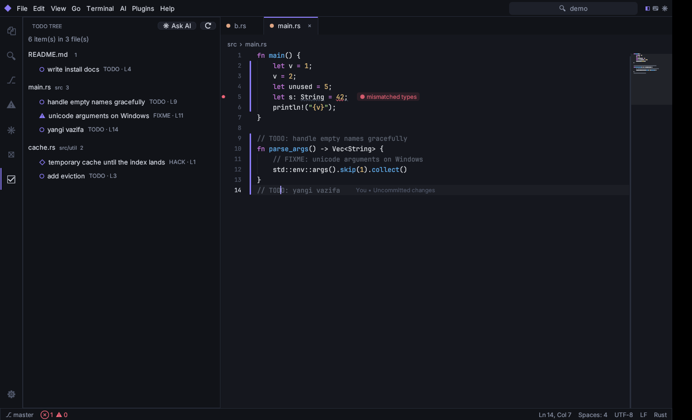

# Zenith plugin qo'llanmasi

Zenith plugini — bu **istalgan tilda yozilgan oddiy dastur**. Editor uni alohida jarayon sifatida
ishga tushiradi va u bilan stdin/stdout orqali **bir qatorda bitta JSON** (JSON Lines) almashadi.

Afzalliklari:
- Har qanday til: Python, Node.js, Go, Rust, Bash…
- Xavfsiz va barqaror: plugin sekin ishlasa yoki yiqilsa ham editor qotmaydi.
- Hech qanday SDK shart emas — JSON o'qish/yozish kifoya.

## Plugin qayerda turadi

```
<config>/plugins/<plugin-papkasi>/plugin.toml     # barcha loyihalar uchun
<workspace>/.zenith/plugins/<plugin-papkasi>/      # faqat shu loyiha uchun
```

`<config>` — sozlamalar papkasi (Plugins paneli → **Folder** tugmasi uni ochadi).
**+ Create sample** tugmasi tayyor namunani yaratadi: [`plugins/examples/text-tools`](../plugins/examples/text-tools).

## Manifest: `plugin.toml`

```toml
id = "text-tools"                 # yagona ID
name = "Text Tools"
version = "0.1.0"
description = "Matn bilan ishlash vositalari"
run = ["python3", "main.py"]      # ishga tushirish buyrug'i (nisbiy yo'llar plugin papkasidan)
events = ["file_saved"]           # ixtiyoriy: "file_opened", "file_saved"

[[commands]]
id = "text-tools.word-count"      # buyruq ID
title = "Text Tools: Word Count"  # palitrada ko'rinadigan nom
```

Buyruqlar avtomatik ravishda **Command Palette**, **Plugins** menyusi va Plugins panelida paydo bo'ladi.
Plugin birinchi buyruq chaqirilganda ishga tushadi (lazy).

## Protokol (v1)

### Editor → plugin

```json
{"id":0,"method":"initialize","params":{"protocol":1,"editor":"zenith","version":"0.1.0"}}
{"id":1,"method":"execute","params":{"command":"text-tools.word-count","context":{...}}}
{"id":2,"method":"event","params":{"event":"file_saved","data":{"path":"/abs/path"}}}
{"method":"shutdown"}
```

`context` maydonlari:

| Maydon | Turi | Tavsif |
|---|---|---|
| `workspace` | string? | Ochiq papka |
| `file` | string? | Aktiv fayl yo'li |
| `language` | string? | Til nomi (masalan `Rust`) |
| `text` | string? | Faylning to'liq matni |
| `selection` | string | Belgilangan matn |
| `cursor_line`, `cursor_col` | number | Kursor (0 dan) |

### Plugin → editor

Javob (`id` so'rovniki bilan bir xil):

```json
{"id":1,"result":{"actions":[{"type":"notify","message":"42 so'z"}]}}
{"id":1,"error":"nimadir xato ketdi"}
```

Istalgan vaqtda (so'rovsiz) ham amal yuborish mumkin:

```json
{"method":"action","params":{"type":"open_file","path":"src/main.rs","line":10}}
{"method":"log","params":{"message":"debug ma'lumot"}}
```

stderr'ga yozilgan hamma narsa log hisoblanadi.

### Amallar (actions)

| `type` | Maydonlar | Natija |
|---|---|---|
| `notify` | `message`, `level`: `info`/`warning`/`error` | Bildirishnoma ko'rsatadi |
| `replace_selection` | `text` | Belgilangan matnni almashtiradi |
| `insert` | `text` | Kursor joyiga qo'shadi |
| `set_text` | `text` | Butun faylni almashtiradi (bitta undo qadami) |
| `open_file` | `path`, `line`? | Faylni ochadi (nisbiy yo'l = workspace'dan) |
| `run_in_terminal` | `command` | Yangi terminalda buyruqni bajaradi |
| `send_to_agent` | `text`, `agent`? | AI agentga matn yuboradi (kerak bo'lsa ishga tushiradi) |
| `set_panel` | `panel`, `items`, `message`?, `buttons`? | Plugin panelining tarkibini almashtiradi (pastga qarang) |

## Yon panel (sidebar panel)

Plugin activity bar'da o'z ikonkasi bo'lgan panel qo'shishi mumkin:

```toml
[[panels]]
id = "todos"
title = "TODO Tree"
icon = "☑"          # bitta belgi; bo'sh bo'lsa sarlavhaning birinchi harfi
```

Foydalanuvchi panelni ochganda (yoki ⟳ bosganda) plugin ishga tushadi va quyidagi hodisani oladi:

```json
{"id":3,"method":"event","params":{"event":"panel_opened","data":{"panel":"todos","context":{...}}}}
```

Plugin panel tarkibini `set_panel` amali bilan yuboradi — javob sifatida yoki istalgan vaqtda (masalan, `file_saved` dan keyin):

```json
{"method":"action","params":{"type":"set_panel","panel":"todos",
  "message":"3 ta vazifa",
  "buttons":[{"title":"✳ Ask AI","command":"todo-tree.ask-ai"}],
  "items":[
    {"label":"main.rs","detail":"src","header":true},
    {"icon":"○","label":"handle empty names","detail":"L9","indent":1,"path":"src/main.rs","line":9},
    {"label":"Qayta ishlash","command":"my.cmd","id":"item-7"}
  ]}}
```

`items` maydonlari: `label`, `detail` (xira matn), `icon`, `header` (bo'lim sarlavhasi), `indent`, `tooltip`;
bosilganda `path` + `line` faylni ochadi, yoki `command` plugin buyrug'ini chaqiradi (`execute` so'rovida
`"item": <id>` bo'ladi). `buttons` — panel sarlavhasidagi tugmalar.

To'liq misol: [`plugins/examples/todo-tree`](../plugins/examples/todo-tree/main.py).



## Eng kichik plugin (Node.js)

```js
// main.js — run = ["node", "main.js"]
const rl = require("readline").createInterface({ input: process.stdin });
rl.on("line", (line) => {
  const msg = JSON.parse(line);
  if (msg.method === "execute") {
    const sel = msg.params.context.selection;
    const actions = [{ type: "replace_selection", text: sel.split("").reverse().join("") }];
    process.stdout.write(JSON.stringify({ id: msg.id, result: { actions } }) + "\n");
  }
});
```
